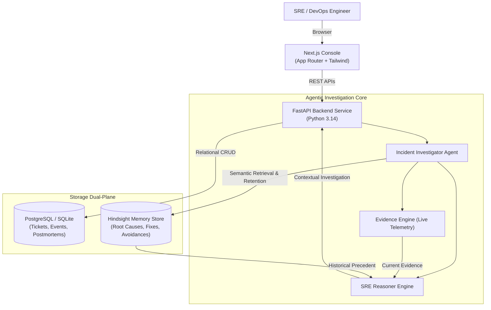

# INCIDENT MEMORY
### AI Incident Response & Root-Cause Agent with Hindsight Memory

> *"Production incidents repeat. Your team's knowledge shouldn't be forgotten."*  
> **Remember what failed. Learn what worked. Investigate the next incident with context.**

[](https://fastapi.tiangolo.com)
[](https://nextjs.org)
[](https://github.com)
[](https://www.typescriptlang.org)
[](https://python.org)

---

## 1. Executive Summary & Core Problem

Production incidents often repeat. Engineering teams frequently solve problems that were already investigated months prior, but the critical operational context remains trapped across dispersed postmortems, Slack channels, git diffs, and Jira tickets.

When a similar outage strikes at 3:00 AM, engineers start from scratch. Worse, they often repeat the same failed troubleshooting attempts (such as restarting pods when the true root cause was a configuration defect), wasting 30 to 60 minutes of critical MTTR.

**Incident Memory** solves this by equipping an autonomous AI incident response engineer with **Hindsight Long-Term Operational Memory**.

The central innovation:
> **HINDSIGHT MEMORY CHANGES HOW THE AI INVESTIGATES THE NEXT INCIDENT.**

---

## 2. The Central Hackathon Story

```
FIRST INCIDENT (INC-071)
       ↓
Investigate & Extract Root Cause (Connection Pool Configuration)
       ↓
Identify What Failed (Pod restart alone failed within 3 minutes)
       ↓
Resolve & Retain in Hindsight
       ↓
SECOND SIMILAR INCIDENT (INC-104)
       ↓
Recall Historical Precedent from Hindsight (87% Historical Relevance)
       ↓
Compare Current Telemetry vs Historical Evidence (Strict SRE Separation)
       ↓
Learned Avoidance: Warn Engineer NOT to repeat failed pod restart
       ↓
Direct Straight to Configuration Parameter Diff (MTTR reduced from 45m to 5m)
```

---

## 3. The Memory Difference (Before vs After)

| Dimension | WITHOUT MEMORY | WITH HINDSIGHT MEMORY |
|---|---|---|
| **Approach** | Isolated telemetry analysis in a vacuum | Precedent-backed telemetry synthesis |
| **Investigation** | Generic runbook triage | Recalls INC-071 pattern instantly |
| **Troubleshooting** | Recommends restarting pods (wasting 30m) | **Warns against pod restart**; highlights past failure |
| **Root Cause** | Uninformed trial-and-error | Targets configuration parameter diffs directly |
| **MTTR** | **45 – 60 Minutes** | **< 10 Minutes** |

---

## 4. Architecture



### Why PostgreSQL and Hindsight Are Separate
- **PostgreSQL / SQLite:** Stores transactional application state (incident logs, timestamps, user actions, raw telemetry).
- **Hindsight:** Stores long-term semantic operational knowledge (what failed, what worked, why specific troubleshooting steps failed, and deployment contexts).

---

## 5. Key Features

- **Enterprise SRE Console:** High-density, professional dark console with live status badges (`ENV: PRODUCTION`, `AI: CONNECTED`, `MEMORY: HINDSIGHT`).
- **Strict Evidence Separation:** Visually separates **CURRENT EVIDENCE** (live traces) from **HISTORICAL MEMORY (NOT CURRENT EVIDENCE)**. The agent is constitutionally restricted from claiming that memory proves current root cause.
- **Root-Cause Evidence Chain:** Visual multi-node explanation path from error detection through deployment context to root cause, complete with a **"Why?"** audited decision factors drawer.
- **Multi-Factor Similarity Scoring:** Historical relevance broken down into:
  - *Service Match (100%)*
  - *Error Similarity (88%)*
  - *Deployment Context (75%)*
  - *Failure Pattern (85%)*
- **Explicit Retrieval Reasons:** Every memory card explains *Why this memory was retrieved*.
- **Learned Avoidance:** Captures troubleshooting dead-ends so future engineers don't repeat them.
- **Automated Blameless Postmortems:** Generates structured postmortems with Markdown copy and JSON export.
- **Service Dependency Topology:** Visual dependency graph linking services to recurring memory signatures.
- **Interactive 2-Stage Demo:** Purpose-built for hackathon judges to verify the memory difference in 3 minutes.

---

## 6. Technology Stack

- **Frontend:** Next.js (App Router), React, TypeScript, Tailwind CSS, Lucide React
- **Backend:** Python 3.14, FastAPI, Pydantic v2, SQLAlchemy 2.0, HTTPX, Uvicorn
- **Database:** PostgreSQL (with SQLite zero-config local fallback)
- **Memory Engine:** Hindsight Memory Provider (with high-fidelity local demo adapter)
- **Testing:** Pytest (100% passing test suite)

---

## 7. Quickstart (Run Locally in 60 Seconds)

### Step 1: Clone and Setup Backend
```bash
cd backend
python -m pip install -r requirements.txt
python -m uvicorn app.main:app --port 8000 --reload
```
*The database automatically creates and seeds 24+ realistic historical incidents across all services on first run.*

### Step 2: Setup and Run Frontend
```bash
cd ../frontend
npm install
npm run dev
```

Open your browser at **`http://localhost:3000`**.

---

## 8. Environment Variables

Create `.env` inside `backend/`:
```ini
ENVIRONMENT=development
PORT=8000
FRONTEND_URL=http://localhost:3000
DATABASE_URL=sqlite:///./incident_memory.db

# Memory Provider: "demo" or "hindsight"
MEMORY_PROVIDER=demo
HINDSIGHT_API_KEY=
HINDSIGHT_ENDPOINT=https://api.hindsight.dev
HINDSIGHT_TENANT_ID=enterprise-sre

# LLM Provider: "demo", "openai", "gemini", or "anthropic"
LLM_PROVIDER=demo
LLM_API_KEY=
LLM_MODEL=gpt-4o
```
*Works out of the box in Demo Mode without requiring paid API keys.*

---

## 9. Testing & Acceptance

Run the backend test suite:
```bash
cd backend
python -m pytest -v
```

All 9 critical tests verify:
- Subsystem health checks
- Incident creation and lifecycle
- Multi-factor memory search and relevance
- Critical integration test: Incident creation → Investigation → Memory recall of INC-071 → Learned avoidance → Resolution & retention → Postmortem generation.

---

## 10. Documentation Index

- [Architecture & Storage Design](docs/architecture.md)
- [3-Minute Hackathon Judge Demo Script](docs/demo-script.md)
- [API Reference](docs/api.md)
- [Hindsight Memory Design](docs/memory-design.md)
- [Testing & Quality Guide](docs/testing.md)

---

## License
MIT License. Built for the Hackathon.
