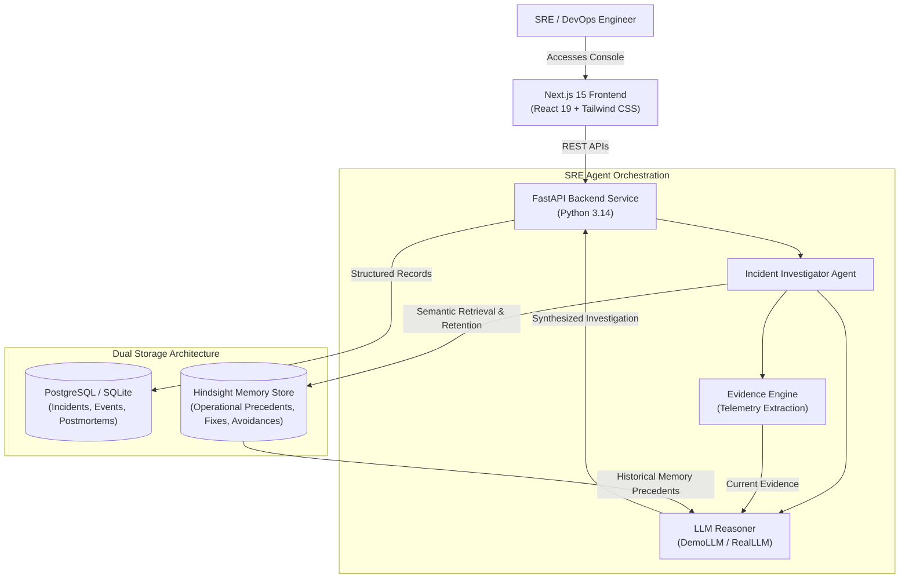
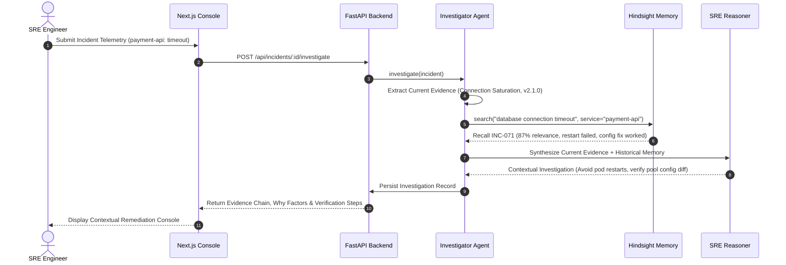

# Architecture & System Design

## Incident Memory: Autonomous SRE Root-Cause Agent with Hindsight Memory

---

## 1. Why Separate PostgreSQL and Hindsight?

A key architectural innovation in Incident Memory is the strict separation between **Structured Application Records** and **Long-Term Operational Memory**:

| Storage Layer | Engine | Purpose | Lifecycle |
|---|---|---|---|
| **Transactional Records** | PostgreSQL / SQLite | Stores ACID-compliant relational data: incident tickets, event timelines, service definitions, resolutions, and generated postmortems. | Immediate CRUD operations with strict relational integrity. |
| **Operational Memory** | Hindsight (Live / Demo Adapter) | Stores semantic abstractions of what failed, what worked, why specific troubleshooting steps failed, and deployment contexts. | Long-term operational learning across services and past quarters. |

### The Value of Separation:
1. **No Data Polluting**: Relational tickets can be closed, archived, or purged according to compliance requirements without erasing the extracted organizational knowledge in Hindsight.
2. **Multi-Factor Semantic Retrieval**: Hindsight scores historical relevance based on four distinct dimensions (Service Match, Error Pattern, Deployment Context, and Failure Signature) rather than simple text lookups.
3. **Safety & Advisory Separation**: The system explicitly marks historical memory as *advisory context* (`HISTORICAL MEMORY — NOT CURRENT EVIDENCE`), guaranteeing that past failures inform current investigations without hallucinating certainty.

---

## 2. End-to-End Investigation Flow

---

## 3. Provider Abstractions (Zero Friction Local Run)

The application enforces a provider pattern:
- **`MemoryProvider`**:
  - `HindsightMemoryProvider`: Queries remote Hindsight cloud when API keys are configured.
  - `DemoMemoryProvider`: Local in-process memory engine with token-overlap, Jaccard similarity, and multi-factor scoring.
- **`LLMProvider`**:
  - `RealLLMProvider`: Interfaces with OpenAI/Gemini/Anthropic with function calling.
  - `DemoLLMProvider`: Deterministic enterprise SRE reasoning engine guaranteeing 100% reliable, zero-latency judging demos.
